  <picture>
    <source media="(prefers-color-scheme: dark)" srcset="assets/header-dark.svg">
    
  </picture>

### hey, I'm Tan

I write code for a living and design whenever nobody stops me. If something looks beautiful or a little bit cool, I have to know how it was made, and then I want to build my own version.

By day I'm a software engineer at a financial company in Thailand. After hours I'm in Blender, messing with three.js, or animating things that were honestly fine standing still.

สายโค้ดที่บ้าดีไซน์ เห็นของสวยของเท่แล้วต้องแกะให้ได้ว่าทำยังไง

  <picture>
    <source media="(prefers-color-scheme: dark)" srcset="assets/divider-dark.svg">
    
  </picture>

  <picture>
    <source media="(prefers-color-scheme: dark)" srcset="assets/toolbox-dark.svg">
    
  </picture>

Solid, Vue and Astro on the web side, MedusaJS when it's commerce, Blender and three.js when a page needs depth. You won't find React here. I think its architecture is a design mistake, and I'm always happy to argue about it over coffee.

  <picture>
    <source media="(prefers-color-scheme: dark)" srcset="assets/duo-dark.svg">
    
  </picture>

Lately I'm deep in AI: agent programming, fine-tuning models, and A2UI, the idea of agents answering with actual UI. Off the clock it's trance on repeat, art, 3D and animation.

<!--
  PROJECTS (TODO, fill in later)
  Add 2-4 project cards here. Suggested format:
  - **project name**: one line about it
    [repo](https://github.com/tanangular/REPO) · [live](https://LIVE-URL)
-->

<!--
  CONTACT (TODO, fill in later)
  e.g. X @cooldezign, website, LinkedIn, email
-->

  <picture>
    <source media="(prefers-color-scheme: dark)" srcset="assets/divider-dark.svg">
    
  </picture>

thanks for scrolling · ขอบคุณที่แวะมานะครับ

